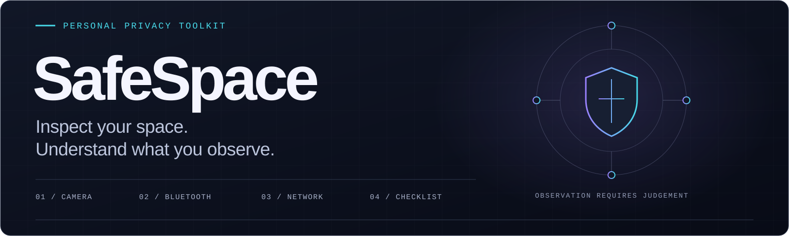
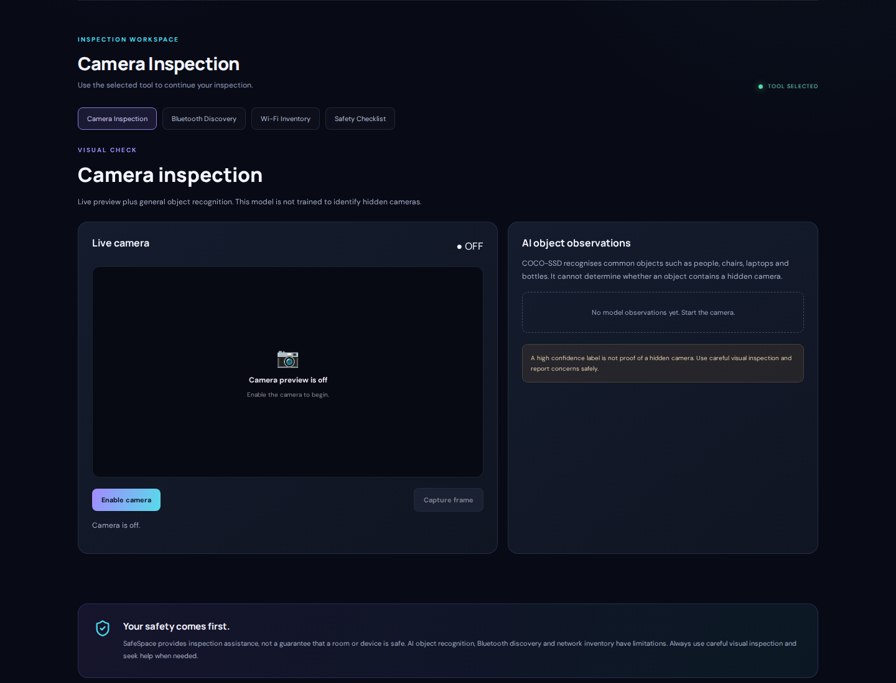
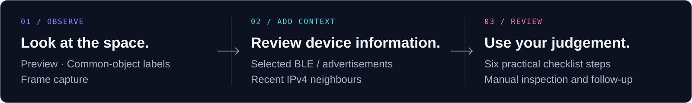
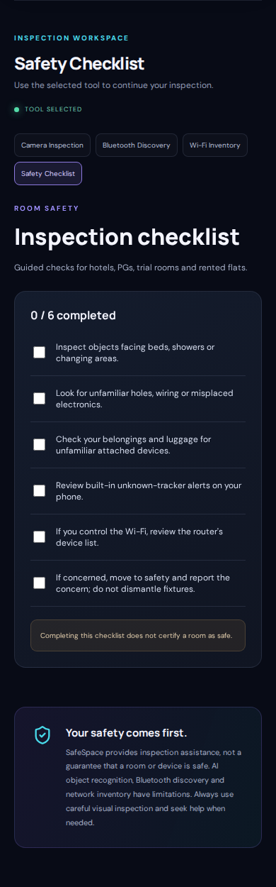

<h1 align="center">
  <picture>
    <source media="(max-width: 600px)" srcset="docs/media/safespace-banner-mobile.svg">
    
  </picture>
</h1>

<p align="center">
  <strong>A local toolkit for informed privacy checks.</strong><br>
  <sub>Experimental · React + TypeScript services · Web / Android packaging · <a href="LICENSE">MIT licensed</a></sub>
</p>

**Created and maintained by [Yeshika0900](https://github.com/Yeshika0900).**

SafeSpace brings **camera inspection, Bluetooth information, local network context and a practical checklist** into one workspace. Look at your surroundings, review what the tools can actually observe, and keep the next decision in human hands.

> **Know the scope:** COCO-SSD recognises ordinary objects. SafeSpace is not a validated hidden-camera or tracker detector, and an empty result does not certify room safety. Physical-device acceptance and Android APK validation remain open.

<p align="center">
  <a href="#see-the-workspace">Workspace</a> ·
  <a href="docs/REVIEWER_GUIDE.md">Walkthrough</a> ·
  <a href="#run-locally">Run locally</a> ·
  <a href="docs/ARCHITECTURE.md">Architecture</a> ·
  <a href="#verification-and-evidence">Evidence</a> ·
  <a href="#license-and-reuse">License</a>
</p>

## See the workspace

<a href="docs/media/camera-workspace-desktop.png"></a>

[Open the full-size workspace](docs/media/camera-workspace-desktop.png) · [Capture provenance](docs/media/README.md)

_Actual Chromium capture. The camera is off; no room imagery, Bluetooth identifiers or real network inventory was collected. This shows the interface, not detection performance._

## An inspection in three steps

<picture>
  <source media="(max-width: 600px)" srcset="docs/media/inspection-path-mobile.svg">
  
</picture>

**Observe.** Use the preview and ordinary-object labels as visual assistance. **Add context.** Review a selected BLE device or the computer's recent neighbours. **Review.** Follow the six practical checklist steps and decide what to inspect manually.

[Follow the controls, expected states and failure cases →](docs/REVIEWER_GUIDE.md)

## Four tools, four kinds of observation

| Tool                | Existing capability                                                                                            | Interpretation limit                                                                                                                 |
| ------------------- | -------------------------------------------------------------------------------------------------------------- | ------------------------------------------------------------------------------------------------------------------------------------ |
| **Camera**          | Local preview, COCO-SSD common-object labels and frame download                                                | A label cannot reveal whether an object contains a hidden camera. Confidence concerns the label.                                     |
| **Bluetooth**       | Browser-selected GATT capabilities or ten-second Android advertisement scanning; local history and JSON export | Names can be spoofed. Aliases are separate from advertised evidence. No characteristic values are read; browser RSSI is unavailable. |
| **Wi-Fi inventory** | The same computer's existing IPv4 neighbour cache through an optional loopback helper                          | Incomplete recent communication, with no active probing, IPv6 coverage or surveillance classification.                               |
| **Checklist**       | Six practical checks with locally saved progress                                                               | A step count records your progress; completion is not a safety assessment.                                                           |

<details>
<summary><strong>View the mobile checklist</strong> — the same tools in a narrow browser viewport</summary>



_Actual 390-pixel Chromium capture, 0/6 checked. This is viewport emulation, not physical-phone acceptance._

</details>

## Built for reviewable observations

- **Clear resource ownership.** Camera Stop works during pending permission/model work. Teardown releases tracks, rejects stale results and serializes inference across remounts. Recognition loads on demand.
- **Bounded, recoverable data.** Tool-local recovery, runtime validation and strict contracts in eight service modules contain malformed storage, external metadata and helper responses.
- **Limited collection.** BLE inspection enumerates capabilities without reading characteristic values. The loopback helper uses fixed OS commands, exact browser origins, time/output limits and coalesced reads.

<sub>React 18 · Vite 6 · TensorFlow.js 4 / COCO-SSD 2.2.3 · Capacitor 8 · Node.js helper</sub>

[Architecture and source map](docs/ARCHITECTURE.md) · [Storage, clearing and backup behaviour](docs/SETUP.md#local-storage-and-privacy)

## Verification and evidence

Software checks and model evaluation answer different questions. The measurements below were recorded at the [14 November 2026 checkpoint](https://github.com/Yeshika0900/SafeSpace/commit/7945a7df9e75262c3b6fe069b67fec8cb828dcfa); the [quality workflow](https://github.com/Yeshika0900/SafeSpace/actions/workflows/quality.yml) shows subsequent software runs.

### Software verification

| Check                                    | Recorded result                      | Scope                                                                                                               |
| ---------------------------------------- | ------------------------------------ | ------------------------------------------------------------------------------------------------------------------- |
| Unit/component + parser/helper + browser | **59 + 52 + 7 passing checks**       | Synthetic sensing/data adapters; seven actual Chromium flows, not physical-device coverage                          |
| Initial JavaScript                       | **2.06 MB → 203 kB**; 90.14% smaller | Production entry bundle, with recognition deferred. Exact bytes: 2,059,548 → 203,164; gzip 358.19 kB → 64,927 bytes |
| Browser layout and recovery              | **320 / 390 / 768 / 1440 px**        | Malformed data, export/clear, zoom, reduced motion and two axe states                                               |

### Generic-object study

Two runs on a **32-image COCO2017 engineering subset**, using TensorFlow.js pure-JS CPU, produced identical labels, scores and boxes. Baseline AP50:95 was **26.79%** on 16 validation images and **29.14%** on 16 holdout images.

A candidate reached 28.58% validation AP50:95, but precision50 fell **94.59% → 88.89%** and false positives rose **2 → 5**. **The candidate was not adopted.** Its argument changed both score filtering and NMS IoU. The small subset, sparse class support, uncertain original checkpoint training membership and missing phone timings do not support a production accuracy-gain claim.

[Full checks and blockers](docs/quality/implementation-status.md) · [Benchmark protocol and limits](docs/quality/benchmark.md) · [Raw predictions](docs/quality/benchmark-run2.json)

## Run locally

The quality and MIT-licensing work are merged into `main`. The commands below use the default branch. Use **Node 24.22.1 LTS / npm 11.9.0** for the recorded setup; tooling requires Node >=22.13.

```sh
git clone https://github.com/Yeshika0900/SafeSpace.git
cd SafeSpace
npm ci
npm --prefix website ci
npm --prefix network-agent ci
npm run dev
```

Open **http://localhost:5173**. No application API key is required. Camera/BLE require permission and a secure context; model assets download on demand. For the optional inventory helper, run `npm run helper` in a second terminal on the **same computer**. It binds to `127.0.0.1:4174`.

Localhost on a phone refers to the phone. Laptop inventory is unsupported there. Android asset sync has passed; APK/lint/native tests remain blocked by Gradle download and SDK/device availability. [Complete setup, validation and Android prerequisites →](docs/SETUP.md)

## Explore the project

| Your next step                                    | Guide                                                                                            |
| ------------------------------------------------- | ------------------------------------------------------------------------------------------------ |
| Review the four tools and expected result states  | [Reviewer walkthrough](docs/REVIEWER_GUIDE.md)                                                   |
| Install, run, test or build                       | [Setup and verification](docs/SETUP.md)                                                          |
| Inspect module ownership and data flow            | [Architecture](docs/ARCHITECTURE.md)                                                             |
| Audit measurements and unfinished acceptance work | [Quality record](docs/quality/implementation-status.md) · [Benchmark](docs/quality/benchmark.md) |
| Check screenshots and presentation sources        | [Media provenance](docs/media/README.md) · [Reference analysis](docs/presentation/README.md)     |
| Contribute or report an issue privately           | [Contributing](CONTRIBUTING.md) · [Security reporting](SECURITY.md)                              |

## License and reuse

**[MIT](LICENSE)** covers SafeSpace's original code, documentation and original artwork. You may use, modify and redistribute the covered work, including commercially, while retaining its copyright and permission notice. The license provides no warranty.

Libraries, icons, fonts, model weights and dataset material keep their own terms. [Third-party notices](THIRD_PARTY_NOTICES.md) retains checked upstream attributions and license texts; the [licensing guide](docs/LICENSING.md) explains the scope and reuse requirements.

Use imagery and device information only where you have permission. Local storage is not encrypted app storage; downloaded frames and reports remain outside history clearing. If an observation concerns you, move to safety and seek appropriate help rather than treating missing observations as clearance.
