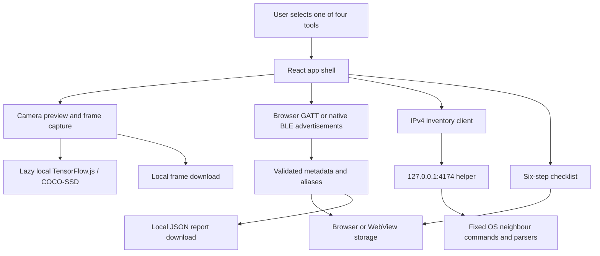

# SafeSpace architecture

SafeSpace uses React/Vite, a Capacitor Android wrapper and an optional Node loopback helper. Four components share one app shell. Typed services own cancellation, records and persistence; the helper separates fixed command execution from IPv4 parsing.

Model packages/weights may be requested from upstream hosts. Room frames are processed locally. The optional helper reads this computer's cache; it is not a phone-to-laptop bridge.

## Source map

| Responsibility                              | Source                                                                                                                                             |
| ------------------------------------------- | -------------------------------------------------------------------------------------------------------------------------------------------------- |
| Entry, shell and style                      | [main.jsx](../website/src/main.jsx), [App.jsx](../website/src/App.jsx), [styles.css](../website/src/styles.css)                                    |
| Tool-local render recovery                  | [ToolBoundary.jsx](../website/src/ToolBoundary.jsx)                                                                                                |
| Camera UI and frame download                | [Camera.jsx](../website/src/features/Camera.jsx)                                                                                                   |
| Generation ownership and teardown           | [camera.ts](../website/src/services/camera.ts)                                                                                                     |
| Lazy model acquisition and settings         | [inference.ts](../website/src/services/inference.ts)                                                                                               |
| BLE UI, history and JSON export             | [BluetoothScan.jsx](../website/src/features/BluetoothScan.jsx)                                                                                     |
| BLE adapters, cancellation and dictionaries | [ble.ts](../website/src/services/ble.ts), [async.ts](../website/src/services/async.ts), [ble-metadata.ts](../website/src/services/ble-metadata.ts) |
| Record validation and persistence           | [records.ts](../website/src/services/records.ts), [storage.ts](../website/src/services/storage.ts)                                                 |
| Network UI and bounded client               | [NetworkScan.jsx](../website/src/features/NetworkScan.jsx), [network.ts](../website/src/services/network.ts)                                       |
| Checklist and saved progress                | [Checklist.jsx](../website/src/features/Checklist.jsx)                                                                                             |
| Loopback HTTP, OS commands and parsers      | [server.js](../network-agent/server.js), [inventory.js](../network-agent/inventory.js)                                                             |
| Native project and configuration            | [website/android](../website/android), [capacitor.config.json](../website/capacitor.config.json)                                                   |

## Resource ownership

Camera sessions reject stale generations. Stop/unmount/background release tracks and clear scheduled work. In-flight inference finishes before its model is disposed; serialization spans remounts. Recognition load failure leaves an available preview usable.

Browser chooser activation stays within the click. Browser GATT inspection and native advertisements have distinct labels/lifecycles. Teardown cancels bounded operations; late selections/connects/scans are disconnected or ignored. Characteristic values are not read. Physical radio behaviour still needs hardware validation.

The network client has a six-second deadline, cancellation and a streamed response-size cap before JSON parsing. The helper has a five-second/256 KiB subprocess bound, coalesced reads and a short cache. Origin/Host/header checks protect browser requests; local processes can forge those headers, so they are not authentication.

## Data and storage

All eight TypeScript service modules are strictly checked. React JSX, the Node helper and benchmark scripts are linted/tested but not type-checked. Runtime validators remain necessary for parsed JSON and external data.

Checklist booleans, the latest 30 sanitized BLE records and friendly aliases use browser/WebView local storage. Version-2 records separate advertised evidence from user labels and discard unnecessary legacy characteristic values. Storage denial can prevent persistent migration or clearing; the UI reports it. Downloads remain separate files. [Storage and backup details](SETUP.md#local-storage-and-privacy).

A tool boundary contains render failures. Missing observations, device names and neighbour entries never become a room-safety score or surveillance verdict.

## Verification boundaries

Fast gates cover synthetic regressions, service contracts, formatting/lint, build/bundle budget, advisories, Gitleaks and Chromium flows. The separate model harness uses pinned public COCO imagery and weights outside Git. CI performs no real sensing.

Hardware/native builds, exact original checkpoint training membership, larger independent evaluation and phone timings remain open. [Checks and blockers](quality/implementation-status.md) · [Benchmark reproduction](quality/benchmark.md) · [Setup](SETUP.md).
